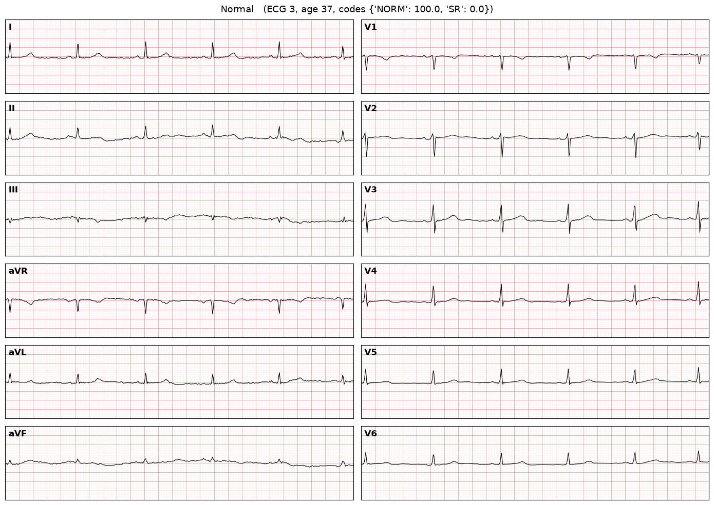
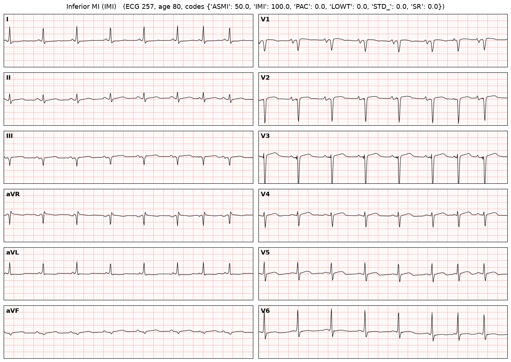
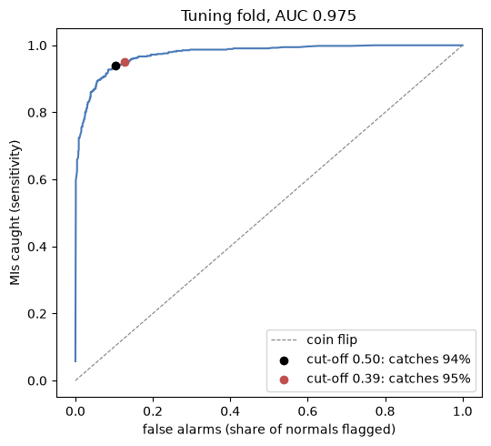

# ECG classifier

Teach a model to spot MIs on real 12-lead ECGs, using the PTB-XL dataset. A learning project, not a medical device.

## Results

All scores are on fold 10, which was locked away until the end and run once.

| Model | Task | Test AUC | Notes |
|---|---|---|---|
| Age alone (no model) | MI vs. normal | 0.81 (tuning fold) | MI patients in PTB-XL are much older |
| MLP, 388k weights | MI vs. normal | 0.82 (tuning fold) | Barely beats age; overfits hard |
| 1D CNN, 104k weights | MI vs. normal | **0.973** | Catches 521 of 550 MIs (94.7%), clears 88.4% of normals |
| 1D CNN, 104k weights | All 5 categories | **0.924** macro | Benchmark paper's best models: about 0.93 |

The cut-off was set on fold 9 to catch 95% of MIs, because in the field a missed MI costs far more than a false
alarm. On the test fold that meant 29 missed MIs and 106 false alarms out of 1,462 ECGs. Most misses were inferior
MIs (20 of 267); anteroseptal MIs were almost never missed (2 of 234).

Limits: MI vs. normal leaves out ECGs with other problems, so it's easier than real life. The MI score inside the
5-category model (0.922) is the more realistic number.

## Notebooks

Notebooks 01-05 were written by Claude as a step-by-step walkthrough. Each one explains itself as it goes.

- `01_explore.ipynb`: the label table, the 5 categories, and a normal ECG next to an MI.
- `02_split_and_baseline.ipynb`: the train / tune / test split (no patient in two splits) and the scores to beat.
- `03_first_model_mlp.ipynb`: a plain MLP, and why it overfits.
- `04_cnn.ipynb`: a 1D convolutional network for MI vs. normal, then all 5 categories.
- `05_tune_and_test.ipynb`: picking the cut-off, the one-time test, and which MIs get missed.
- `ecg_common.py`: the shared pieces: loading the data, the split, the network, the training loop and the scores.
- `explore.ipynb`: a scratch notebook for trying things by hand.

## Run it yourself

1. `pip install -r requirements.txt` (tested on Python 3.14).
2. Download PTB-XL 1.0.3 into `data/ptb-xl/`, either as the 1.7 GB zip from
   https://physionet.org/content/ptb-xl/1.0.3/ (unzip it and rename the folder), or with PhysioNet's faster AWS copy:
   `aws s3 sync --no-sign-request s3://physionet-open/ptb-xl/1.0.3/ data/ptb-xl/`
3. Run the notebooks in order, from this folder.

The first notebook to run reads all 21,799 ECG files (about 7 minutes) and saves them as `data/X100.npy`. After
that, each notebook starts in seconds. Training the CNN takes about 7 minutes on a CPU. Trained models are saved in
`models/`, charts in `figures/`.

## Where the data is

- `data/ptb-xl/`: the dataset, about 3 GB. `.gitignore` keeps it off GitHub.
  - `ptbxl_database.csv`: one row per ECG, with its labels (`scp_codes`), its fold (`strat_fold`) and its file
    (`filename_lr`).
  - `scp_statements.csv`: what each label code means, and which of the 5 big categories it falls under
    (`diagnostic_class`).
  - `records100/`: every ECG at 100 samples per second. `records500/` has the same ECGs at 500.
  - `example_physionet.py`: PhysioNet's short example of loading the data and labels.
- Dataset docs: https://physionet.org/content/ptb-xl/1.0.3/

## Steps

- [x] 1. Explore: load the ECGs, plot all 12 leads, put a normal one next to an MI.
- [x] 2. Split: train on folds 1-8, tune on fold 9, test on fold 10 only at the very end.
- [x] 3. Baseline: "always guess normal" and "age alone", the scores a model has to beat.
- [x] 4. First model, MI vs. normal: an MLP.
- [x] 5. Better model with 1D convolutions, then all 5 categories.
- [ ] 6. Write-up: tuned to catch 95% of MIs and drafted above. Still to do: put it on GitHub.

## Credit

PTB-XL is free to use under CC BY 4.0, which means crediting it when you share the project:

Wagner, P., Strodthoff, N., Bousseljot, R., Samek, W., & Schaeffter, T. (2022). PTB-XL, a large publicly available
electrocardiography dataset (version 1.0.3). PhysioNet. https://doi.org/10.13026/kfzx-aw45

Benchmark: Strodthoff, N., Wagner, P., Schaeffter, T., & Samek, W. (2021). Deep Learning for ECG Analysis:
Benchmarks and Insights from PTB-XL. IEEE Journal of Biomedical and Health Informatics, 25(5), 1519-1528.
